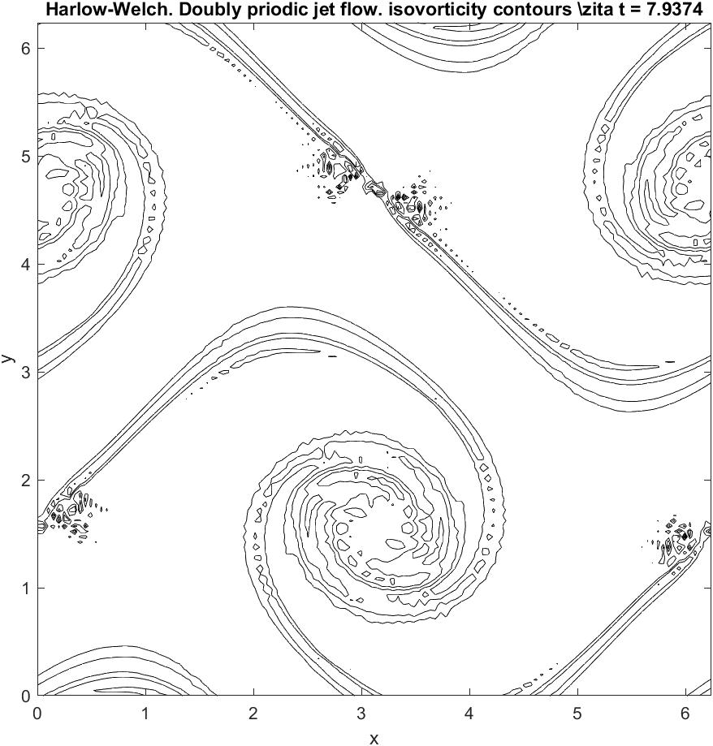
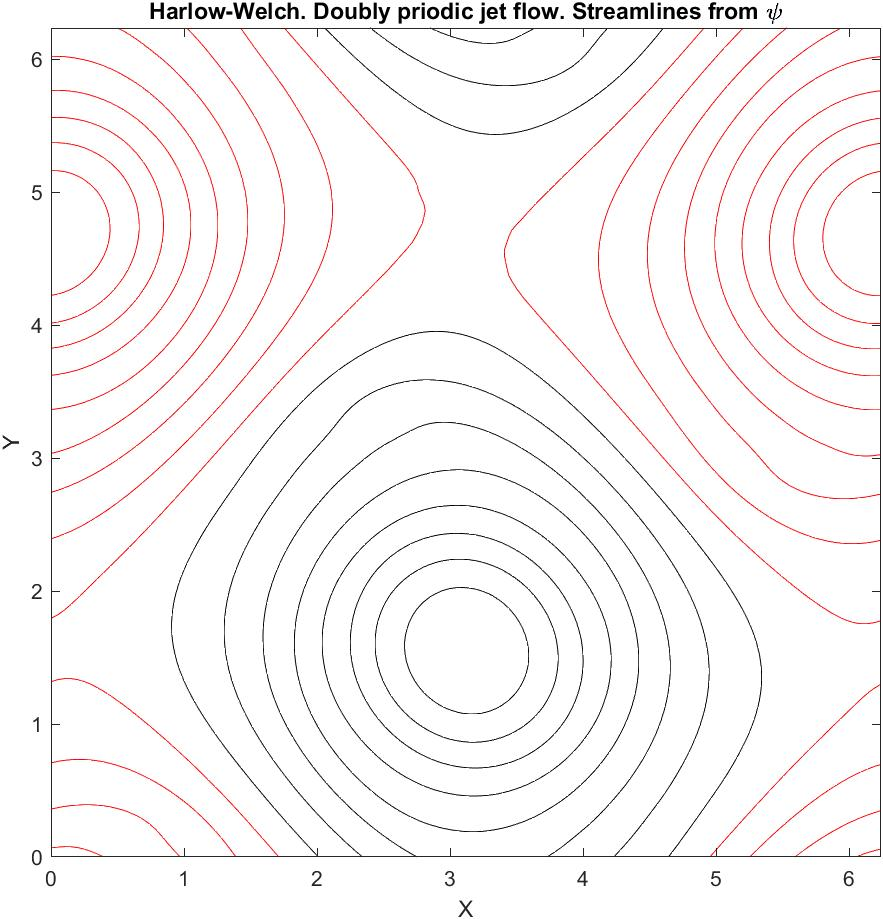
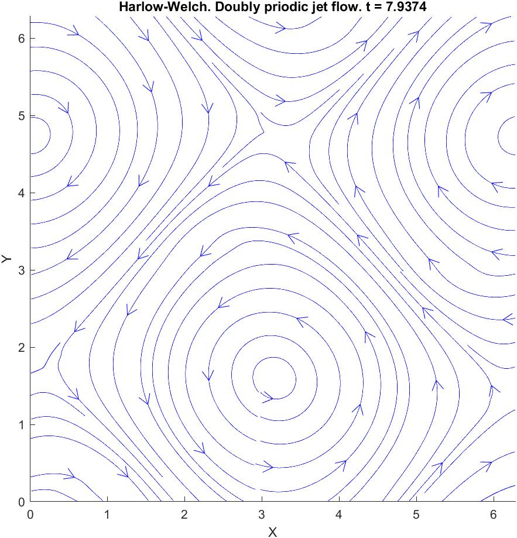
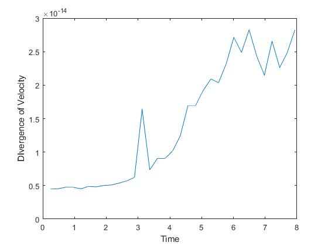
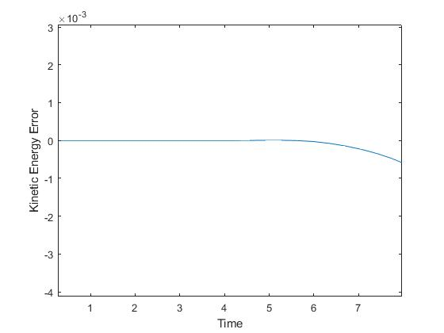
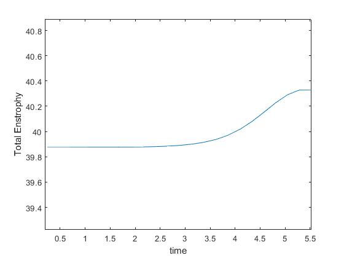

# Double Jet Flow – Fractional Step Method for 2D Incompressible Navier-Stokes

MATLAB solver for the **2D incompressible Navier-Stokes equations** in primitive variables, based on the **Fractional Step (projection) method** with **4-stage Runge-Kutta** time integration on a **Harlow-Welch staggered grid**.

The solver is tested on a classic benchmark: the **double shear layer (double jet) in a doubly periodic domain**. A small transverse perturbation makes the two jets roll up into vortices that mix the layers. The results are compared with the reference study by Knikker (2009).

Project developed for the *Computational Fluid Dynamics* course, MSc in Mathematical Engineering, University of Naples Federico II (A.Y. 2022-2023).

<p align="center">
  
  
</p>

## Method

**Governing equations.** Incompressible, Newtonian, two-dimensional flow in a biperiodic domain:

$$\nabla \cdot \mathbf{v} = 0, \qquad \frac{\partial \mathbf{v}}{\partial t} + \nabla \cdot (\mathbf{v}\mathbf{v}) = -\nabla p + \nu \nabla^2 \mathbf{v}$$

**Fractional Step Procedure.** Based on the Helmholtz decomposition, each step:

1. computes an intermediate velocity field $\mathbf{v}^*$ neglecting the pressure gradient;
2. solves the **pressure Poisson equation** $\nabla^2 p = \nabla \cdot \mathbf{v}^* / \Delta t$;
3. projects $\mathbf{v}^*$ onto the divergence-free space: $\mathbf{v}^{n+1} = \mathbf{v}^* - \Delta t \, \nabla p$.

The projection is applied at **every Runge-Kutta stage**, so the velocity field satisfies the divergence-free constraint at each step (proof in the [report](docs/report.pdf)).

**Spatial discretization.**
- **Harlow-Welch staggering:** u on the vertical cell faces, v on the horizontal faces, p at cell centers. This avoids the loss of mass conservation of collocated grids and makes the two-point difference formulas second-order accurate.
- Second-order central differences for divergence, gradient and Laplacian.
- Convective terms computed by interpolating the velocities at cell centers and corners before differencing.
- Periodic boundary conditions built directly into the discrete Laplacian.

**Test case.** Domain $[0, 2\pi]^2$, 180 × 180 cells, inviscid flow, Courant number 0.4, final time T = 10. Initial conditions:

$$u(x,y,0) = \begin{cases} \tanh\left(\dfrac{y - \pi/2}{\delta}\right) & y \le \pi \\[2mm] \tanh\left(\dfrac{3\pi/2 - y}{\delta}\right) & y > \pi \end{cases} \qquad v(x,y,0) = \epsilon \sin(x)$$

with shear layer thickness $\delta = \pi/15$ and perturbation amplitude $\epsilon = 0.05$.

## Results

| Velocity field (t ≈ 8) | Isovorticity contours, ζ = ±1…±6 (t ≈ 8) |
| --- | --- |
|  |  |

**Conservation properties**, the main check of the scheme's quality:

| Divergence of velocity | Kinetic energy error | Total enstrophy |
| --- | --- | --- |
|  |  |  |

- **Mass:** the maximum divergence of the velocity stays at machine precision (~10⁻¹⁴) for the whole simulation.
- **Kinetic energy and enstrophy:** both are well conserved during the early phase. They start to drift once the vortices form and steep gradients develop, the same qualitative behaviour reported for second-order schemes in the reference study.

The full derivation, the discretization schemes and the comparison with the reference results are in the [report](docs/report.pdf).

## Repository structure

```
├── src/
│   ├── double_jet_main.m          # Main script: setup, time loop, plots
│   ├── RHS_Periodic_HW.m          # Convective terms on the staggered grid
│   ├── Div_Calc_periodic_HW.m     # Discrete divergence (periodic)
│   ├── Grad_Calc_periodic_HW.m    # Discrete pressure gradient (periodic)
│   ├── GivePsiZita_periodic.m     # Vorticity and stream function
│   └── Kinetic_energy.m           # Total kinetic energy
├── octave/                        # numgrid / delsq replacements for GNU Octave
├── results/                       # Figures from the simulation
└── docs/report.pdf                # Full project report
```

## How to run

**MATLAB:** open the `src` folder and run `double_jet_main`. Plots of velocity, streamlines and vorticity are updated every 10 time steps; conservation diagrams are shown at the end.

**GNU Octave:** add the compatibility functions to the path, then run the main script:

```matlab
addpath('octave'); cd src; double_jet_main
```

With the default 180 × 180 grid the simulation takes a few minutes. Reduce `Ncx` in `double_jet_main.m` for a quicker test.

## Reference

R. Knikker, *Study of a staggered fourth-order compact scheme for unsteady incompressible viscous flows*, International Journal for Numerical Methods in Fluids, 59(10), 1063-1092 (2009).

## Author

**Michele Fornaro** – Control Engineer, MSc in Mathematical Engineering
